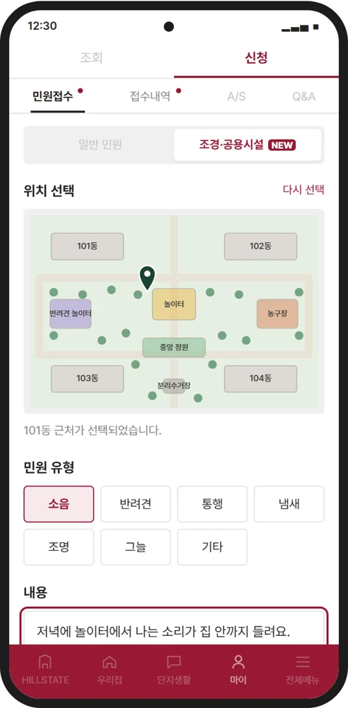
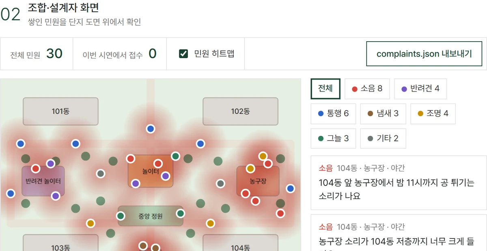
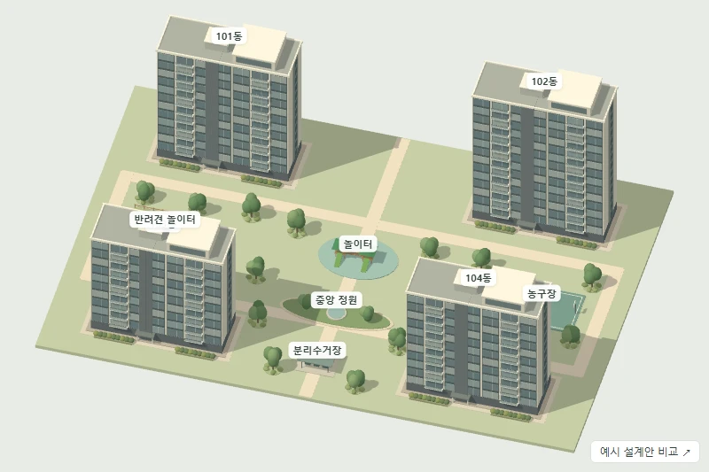
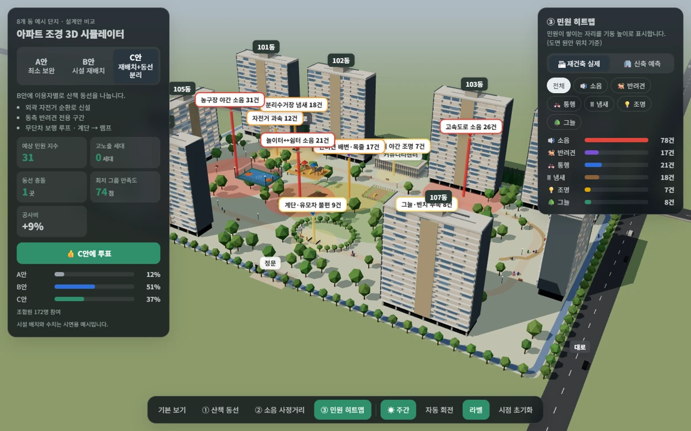

# 가든스테이트 · Garden State

**입주민 민원을 설계로 되돌리는 AI 조경 설계 도우미**

2026 SVC Seoul AI 해커톤 with 현대건설 · 주제 ② AI 아파트 조경공간 설계·시공 도우미

아파트 조경 민원은 입주 후에 쌓이지만, 텍스트로 흩어져 있어 다음 설계에 반영되지 않는다. 설계안 하나를 두고 설명회·이견·재설계가 반복되면서 시공사와 입주민 모두 지친다. 가든스테이트는 **민원에 위치와 유형을 붙여 모으고, 조합·설계자가 같은 단지 도면 위에서 민원이 몰리는 곳을 보며** 조경 계획을 고치고 A/B/C안을 함께 고르도록 돕는다.

**[가든스테이트 웹 데모 체험하기 →](https://gardenstate-2026.github.io/gardenstate-web/)** · 설치 없이 브라우저에서 열 수 있다.

현재 데모에서 민원을 접수하고, 조합·설계자 화면의 2D·3D 단지 배치와 민원 히트맵에서 확인할 수 있다. 별도 예시 설계안 화면에서는 A/B/C 배치와 산책 동선, 소음 영향 범위를 비교할 수 있다.

## Demo Screenshots

| 입주민 민원 접수 | 조합·설계자 민원 히트맵 · 2D 보기 |
| --- | --- |
|  |  |

| 3D 단지 배치 | 3D 예시 설계안 · 야간 민원 히트맵 |
| --- | --- |
|  |  |

## 핵심 기능

| 기능                   | 하는 일                                                                            |
| ---------------------- | ---------------------------------------------------------------------------------- |
| **민원 히트맵**        | 민원을 위치·유형·시간대로 구조화해 배치도 위에 "여기에는 민원이 많아요"를 표시한다 |
| **산책 동선 최적화**   | 보행자·자전거·반려견·유모차가 엉키는 지점을 찾고 분리·연결된 동선을 제안한다       |
| **소음·불편 사정거리** | 놀이터·농구장·분리수거장 등 시설의 영향 범위를 시간대별 색으로 보여준다            |
| **A/B/C안 비교·투표**  | 민원 위험이 낮은 배치안을 지표와 그림으로 비교하고 투표로 확정한다                 |

핵심 시나리오는 아래 두 가지이다.

- **재건축**: 기존 단지에서 실제로 받은 민원으로 위험 구역을 찾는다.
- **신축**: 시설 배치가 비슷한 기존 단지의 민원 패턴으로 위험을 예측한다.

민원 수집은 현대건설 입주민 앱 **my HILLS의 민원 접수에 위치·유형 태깅을 추가하는 기능 제안**으로 다룬다.

## 실행과 공개 데모

Node 20.19 이상이 필요하다 (`.nvmrc`: 22).

```bash
nvm use
pnpm install
pnpm dev
```

`http://localhost:5173/gardenstate-web/`을 열고 **민원 접수 체험하기**를 누른다. 왼쪽 휴대폰 화면에서 민원을 접수하면 오른쪽 조합·설계자 화면에 바로 표시된다. **예시 민원 30건 불러오기**로 민원이 쌓인 상태를 바로 볼 수 있다.

공개 데모는 `main` 브랜치에 올라가면 GitHub Actions로 GitHub Pages에 자동 배포한다. 단지와 민원은 모두 가상 데이터이며, 입력한 민원은 이 브라우저의 localStorage에만 저장하고 서버로 보내지 않는다.

| 명령                                | 역할                            |
| ----------------------------------- | ------------------------------- |
| `pnpm dev`                          | 개발 서버                       |
| `pnpm build`                        | 타입 검사 + 정적 빌드 (`dist/`) |
| `pnpm preview`                      | 빌드 결과 미리보기              |
| `pnpm lint`                         | oxlint 검사                     |
| `pnpm format` / `pnpm format:check` | Prettier 정리 / 검사            |

## 사용 흐름

1. **위치 핀 찍기** — 입주민이 my HILLS 민원 접수 화면의 단지 배치도에서 불편을 느낀 곳을 누른다.
2. **유형·내용 입력** — 소음·반려견·통행·냄새·조명·그늘·기타 중 유형을 고르고 내용과 사진(선택)을 남긴다.
3. **AI 해석** — 민원 문장에서 유형·시간대·원인 시설을 추출해 카드로 보여준다. 현재는 키워드 목업이며 화면에 "목업"으로 표시한다.
4. **도면 위 확인** — 조합·설계자 화면에서 민원을 핀과 히트맵으로 보고, 유형별로 걸러 본다.
5. **데이터 전달** — 쌓인 민원을 `complaints.json`으로 내보내 3D 시뮬레이터와 분석에 넘긴다.
6. **설계안 비교·투표** — 민원 분석을 반영한 A/B/C안을 비교하고 투표한다. (해커톤 기간 구현)

## 지금 구현한 것

| 기능                                    | 현재 상태                                                                                                           |
| --------------------------------------- | ------------------------------------------------------------------------------------------------------------------- |
| 랜딩, 입주민·조합 두 화면               | 구현. 같은 탭에서 상태 공유. 넓은 화면은 나란히, 좁은 화면은 위아래로 배치                                          |
| 민원 접수 (위치 핀·유형·내용·사진 여부) | 구현. 위치·유형·내용이 없으면 접수 차단                                                                             |
| 민원 해석 카드                          | 키워드 목업. `VITE_AI_API_URL`을 설정하면 AI 모듈로 요청하고, 실패하면 목업으로 대신함                              |
| 배치도 위 민원 핀·히트맵·유형 필터      | 구현. 2D 배치도 기준                                                                                                |
| 예시 민원 30건, JSON 내보내기           | 구현. [`public/data/complaints.sample.json`](public/data/complaints.sample.json) 제공                               |
| 3D 시뮬레이터 연결                      | 내장 3D에서 민원 핀, 히트맵, 선택 상태를 연동한다. 외부 시뮬레이터 주소는 `VITE_SIMULATOR_URL`로 설정한다. |
| 스케치업 모델 반영                      | 미연동. 좌표계만 맞춰 둠                                                                                            |
| 산책 동선 최적화, 소음 사정거리         | 미구현. 3D 시뮬레이터 쪽 레이어로 구현 예정                                                                         |
| A/B/C안 비교·투표                       | 미구현. `features/proposal` 자리만 있음                                                                             |
| 서버 저장, 여러 기기 간 공유, 인증      | 미구현. 현재 민원은 각 브라우저에만 저장                                                                            |

## 설계 원칙

- **같은 좌표계를 쓴다.** 원점은 단지 중앙, 단위는 m이다. 2D 배치도·3D 시뮬레이터·스케치업 모델이 같은 `(x, z)`를 공유한다.
- **AI는 해석과 제안만 한다.** 대안과 근거를 보여주고, 최종 결정은 설계자·조합·발주처가 한다.
- **목업은 목업이라고 표시한다.** AI 연결 전 해석 결과에는 `source: "mock"`과 화면 표시를 붙인다.
- **모듈 이름을 백엔드 설계와 맞춘다.** 프론트 폴더, API, 다이어그램이 같은 이름(`complaint`, `analysis`, `site`, `proposal`)을 쓴다.
- **연결부만 바꾸면 교체되게 한다.** 저장소는 `useComplaints`, AI는 `analyzeComplaint`, 3D는 `SimulatorSlot` 안쪽만 바꾸면 된다.

## 구조와 문서

| 경로                               | 역할                                            | 백엔드 설계 대응  |
| ---------------------------------- | ----------------------------------------------- | ----------------- |
| `src/app/`                         | 랜딩과 체험 영역 조립                           | —                 |
| `src/features/complaint/`          | 민원 타입, 접수 화면, 목록, 저장 훅, 예시 민원  | 민원 API, 민원 DB |
| `src/features/analysis/`           | 민원 문장 해석 (AI 연결부, 현재 목업)           | AI 분석 서비스    |
| `src/features/site/`               | 단지 좌표 데이터, 2D 배치도, 3D 시뮬레이터 자리 | 도면·모델 저장소  |
| `src/features/proposal/`           | A/B/C 비교·투표 (예정)                          | 설계안·투표 API   |
| `src/shared/`                      | 스타일, 저장소 유틸                             | —                 |
| `.github/workflows/deploy.yml`     | GitHub Pages 자동 배포                          | —                 |
| [데이터 형식](docs/data-format.md) | 좌표계, `complaints.json`, 3D·AI 연결 방법      | —                 |

## 연결 설정

`.env.example`을 `.env`로 복사해 주소를 채운다. 비워 두면 목업과 2D 배치도로 동작한다.

```bash
cp .env.example .env
```

| 변수                 | 역할                    |
| -------------------- | ----------------------- |
| `VITE_AI_API_URL`    | AI 민원 해석 모듈 주소  |
| `VITE_SIMULATOR_URL` | 3D 단지 시뮬레이터 주소 |

배포 환경에서는 레포 **Settings → Secrets and variables → Actions → Variables**에 같은 이름으로 넣는다.

## 배포

1. 레포 **Settings → Pages → Source**를 **GitHub Actions**로 설정한다.
2. `main`에 올리면 `.github/workflows/deploy.yml`이 빌드하고 배포한다.
3. 주소는 `https://gardenstate-2026.github.io/gardenstate-web/`이다.

레포 이름을 바꾸면 `vite.config.ts`의 `base`도 같이 바꾼다.

## 검증 현황

로컬에서 `pnpm build`(타입 검사 포함), `pnpm lint`, `pnpm format:check`를 통과했다.

브라우저에서 위치 미선택 시 접수 차단, 민원 접수, 목업 해석 카드(유형·위치·시간대·원인 시설), 조합·설계자 화면의 핀·목록 즉시 반영을 확인했다. 폭 457px 화면에서 가로 스크롤이 생기지 않는 것도 확인했다.

자동 테스트는 아직 없다. GitHub Pages 배포, 실제 모바일 기기, 3D 시뮬레이터·AI 모듈 실제 연결은 아직 확인하지 않았다.

## 데이터와 개인정보

모든 단지·시설·민원은 가상 데이터이다. 실제 단지나 실제 민원을 의미하지 않는다.

입력한 민원은 브라우저 localStorage에만 저장하고 외부로 보내지 않는다. 사진은 첨부 여부만 기록하고 이미지 파일은 저장하지 않는다. 민원에 이름·연락처·동호수 필드를 두지 않는다. 실제 서비스에서는 민원 위치를 동·구역 단위로 집계하고 비식별 처리하는 것을 전제로 한다.
